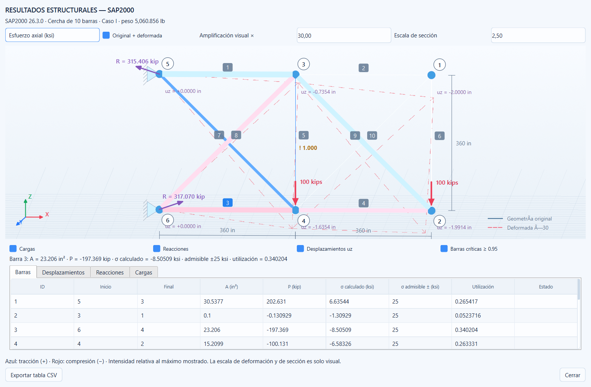

# TrussLab3D

Aplicación de escritorio en Python para modelar cerchas planas y espaciales, analizar su respuesta axial y optimizar sus áreas con FEM independiente y SAP2000 OAPI.



## Modelador desde cero

**Nuevo** inicia una cercha 2D o 3D vacía. Crea nodos con **XYZ…** o con el ratón sobre el plano de trabajo, conecta sus extremos y confirma sus propiedades con Enter o **Aplicar cambios**. Los borradores se pueden guardar sin barras ni apoyos. **Cargas** administra patrones y casos; **Bibliotecas** administra materiales, secciones y límites. **Validar** comprueba estabilidad y **Analizar** calcula la respuesta.

Consulta la [guía del modelador y arquitectura](docs/MODELADOR.md) y la [verificación ejecutada](docs/VALIDACION_MODELADOR.md). El Caso I sigue disponible como ejemplo y conserva el límite verificado de **25 ksi**.

## Funciones actuales

- Modelador 2D/3D vacío, dibujo sobre plano, selección múltiple, edición numérica, copiar, mover, eliminar y deshacer/rehacer.
- Materiales por barra, biblioteca de secciones y patrones/casos de carga con combinaciones lineales.
- Restricciones verificadas en todos los casos seleccionados durante la optimización.
- Laboratorio de campañas con ASAM, DE, SLSQP y sus refinamientos híbridos; trazas, estadísticas e informes.
- FEM matricial con comprobación de estabilidad, equilibrio y restricciones.
- Optimización de tamaño mediante **ASAM, DE y SLSQP**, con variables individuales o agrupadas.
- Motores seleccionables: **FEM**, **SAP2000 por candidato** e **híbrido FEM + SAP**.
- Sesión SAP propia persistente para optimización; actualiza secciones sin abrir otra instancia por candidato.
- Apertura visible en SAP y actualización mediante una copia nueva, conservando modelos anteriores.
- Panel **RESULTADOS ESTRUCTURALES — SAP2000**: axiales, esfuerzos, deformada, desplazamientos, reacciones, cargas y utilización.
- Presupuesto de evaluaciones, semilla, progreso, pausa y detención controladas.
- Proyectos JSON, resultados CSV, vistas PNG y trazas científicas exportables.

## Instalación e inicio en Windows

Requiere **Python 3.11 de 64 bits**. SAP2000 se necesita únicamente para los modos SAP e híbrido; el análisis y la optimización FEM funcionan de forma independiente.

```powershell
git clone https://github.com/frankrac123/repositorio-FEM.git
cd repositorio-FEM
powershell -ExecutionPolicy Bypass -File .\Instalar.ps1
.\Abrir_TrussLab.cmd
```

También puedes abrir `TrussLab3D.exe` después de instalar las dependencias. Es un lanzador del código Python de esta carpeta, cuyo fuente está en `launcher.cs`; requiere el entorno `.venv` y no es un instalador autónomo.

Instalación manual equivalente:

```powershell
python -m venv .venv
.\.venv\Scripts\python.exe -m pip install -r requirements.txt
.\.venv\Scripts\python.exe run.py
```

`requirements-lock.txt` fija las versiones del entorno de escritorio probado; `requirements.txt` lo referencia. `pyproject.toml` declara el paquete y sus dependencias principales. Si falla el inicio, consulta el archivo local `data/startup_error.log`.

## Conexión con SAP2000

La integración se comprobó con **SAP2000 26.3.0**, Windows y `SAP2000v1.Helper`. SAP2000 y su licencia deben estar instalados por separado; no se distribuyen aquí.

Si el programa no encuentra el ejecutable en sus rutas predeterminadas, configura una ruta existente antes de iniciar TrussLab:

```powershell
$env:TRUSSLAB_SAP_EXE='C:\ruta\de\SAP2000.exe'
.\.venv\Scripts\python.exe run.py
```

El modo SAP analiza realmente cada candidato y recupera sus resultados mediante OAPI. Si falla, informa del problema; no cambia silenciosamente al FEM. En híbrido, los candidatos no enviados a SAP se identifican como pendientes de verificación externa.

El botón **ABRIR EN SAP2000** conserva la sesión visible. **Actualizar modelo en SAP2000 (nueva copia)** crea otro modelo sin sobrescribir el anterior. Los análisis automáticos y la optimización cierran únicamente las instancias que crearon. La pausa y la detención esperan al final de la llamada COM en curso.

Consulta [la guía de SAP2000](docs/SAP2000_VISIBLE.md).

## Uso inicial

El programa inicia con un documento vacío. **Nuevo** permite elegir una cercha 2D/3D o un ejemplo; **Abrir** recupera proyectos guardados, incluido `examples/Caso_I_calculado.trusslab.json`. **Analizar** calcula el caso activo; **Optimizar** configura algoritmo, motor, variables, grupos y parámetros. El laboratorio compara los cinco métodos existentes sobre todos los casos seleccionados.

Los cambios del modelo invalidan los resultados anteriores; confirma la edición y pulsa **Analizar** cuando corresponda. Una estructura inestable se informa como tal. Atajos: Ctrl+N, Ctrl+O, Ctrl+S, F5 FEM, F6 SAP y Supr para eliminar la selección.

También hay una interfaz numérica básica:

```powershell
.\.venv\Scripts\python.exe -m trusslab.cli fem --output data
.\.venv\Scripts\python.exe -m trusslab.cli optimize --method SLSQP --output data
```

La interfaz gráfica y la API `trusslab.optimization.optimize` ofrecen la configuración completa de ASAM y de los motores.

## Benchmark: diez barras, Caso I

| Parámetro | Valor |
|---|---|
| Geometría | Dos tramos de 360 in; altura 360 in; seis nodos y diez barras |
| Plano y apoyos | XZ, Y restringido; nodos 5 y 6 apoyados |
| Cargas | −100 kip en Z en nodos 2 y 4; sin cargas del Caso II |
| Módulo elástico | 10000 ksi |
| Peso específico | 0.10 lb/in³ |
| Áreas | 0.1–35 in² |
| Esfuerzo admisible | **±25 ksi**, benchmark confirmado para este proyecto |
| Desplazamiento admisible | ±2 in por componente libre |
| Peso propio | Desactivado en el patrón de cargas |
| Objetivo | W = Σ γ A L, expresado en **lb** |

El texto del artículo contiene una discrepancia de 20/25 ksi, documentada en [la metodología](docs/ASAM_Y_MOTORES.md); este benchmark usa 25 ksi. El material se denomina benchmark: E = 10000 ksi no se presenta como acero A36.

## Pruebas y estado científico

```powershell
.\.venv\Scripts\python.exe -m pytest -q
```

Consulta la [auditoría de estabilización](AUDITORIA_ESTABILIZACION_TRUSSLAB.md) y sus registros para los conteos y commits comprobados. La suite ordinaria no abre SAP ni ventanas Qt. Las pruebas Qt y SAP reales requieren activación explícita; GitHub Actions verifica el núcleo numérico en Windows y Linux.

ASAM produjo diseños factibles de **5114.494, 5097.239 y 5082.111 lb** para semillas 42, 7 y 17. La repetición de semilla 42 dio las mismas áreas. Estas corridas se comprobaron con FEM y siguen pendientes de validación SAP individual. Todavía no reproducen el mejor peso publicado de 5060.877 lb; no se afirma optimalidad global. El ejemplo anterior SLSQP de aproximadamente 5060.856 lb se conserva con su evidencia.

Están implementados el laboratorio comparativo, los informes PDF/Excel y los materiales/patrones/casos múltiples. Siguen fuera del alcance GA/PSO, pandeo, perfiles comerciales y optimización de geometría/topología. El cálculo actual es lineal elástico axial de cerchas, sin vigas, pórticos ni análisis de edificios.

## Organización del repositorio

| Ruta | Contenido |
|---|---|
| `trusslab/` | Modelo, FEM, ASAM, optimizadores, SAP OAPI, interfaz y visor 3D |
| `tests/` | Pruebas físicas, algoritmos, validación y sesiones SAP |
| `scripts/` | Reproducción de ejemplos y ensayos documentados |
| `examples/` | Proyectos listos para abrir y diseños calculados |
| `docs/` | Fundamentos, guías, pruebas y limitaciones |
| `data/` | Evidencias seleccionadas; datos nuevos de ejecución quedan locales |
| `.github/workflows/` | Pruebas automáticas en Windows y Linux |
| `run.py`, `Abrir_TrussLab.cmd` | Inicio de la aplicación |
| `launcher.cs`, `TrussLab3D.exe` | Fuente y lanzador de Windows |

Consulta el [índice de documentación](docs/INDEX.md) y el [informe de las etapas 2–4](docs/VALIDACION_FASE3.md). Se conserva el historial Git con el punto previo a la ampliación (`pre-phase3-20261017`). Los entornos virtuales, dependencias instaladas, cachés y archivos temporales de SAP no forman parte del repositorio.


## Núcleo y documentos auditados

`truss_kernel.py` contiene la única formulación FEM; `fem.solve(model, case=...)` y `PreparedTruss` son interfaces compatibles que la utilizan. El modelo central conserva geometría, áreas individuales efectivas, materiales, cargas y restricciones. Las áreas de sección inicializan o actualizan las asignaciones; la optimización modifica el área efectiva de cada barra.

Se guarda `trusslab/3` y se leen las versiones 1/2. La carga de un documento con resultados comprueba su huella y contrasta sus valores con FEM; descarta resultados e historial incompatibles. Un borrador sin resultados no ejecuta análisis al abrirse. `density` representa peso específico en lb/in³; nunca densidad de masa. El peso se expresa en lb y la carga gravitatoria equivalente se convierte a kip dividiendo entre 1000.

La factibilidad utiliza tolerancia relativa 1e-6; `strict_feasible` identifica cumplimiento estricto. Una corrida fallida conserva su mejor diseño previo como evidencia separada y no se declara exitosa.
